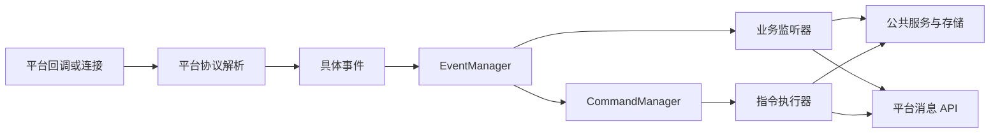

# 架构与生命周期

[文档目录](../README.md) · [平台与消息](platforms.md)

## Gradle 模块

| 模块 | 内容 |
| --- | --- |
| `atri-core` | QQ / QQ 频道 / Napcat 接入、消息 API、事件、指令分发、HTTP、线程与通用调度器 |
| 根项目 | 业务指令、数据库、账号管理、审核、欢迎配置、插件加载、WebUI / Miniapp |

依赖方向为根项目 → `atri-core`。框架不引用运行服务入口、Repository 或业务配置类

[AtriProvider](../../atri-core/src/main/java/top/yzljc/atricore/AtriProvider.java) 是框架服务的统一入口，`initialize()` 自动注册实例、准备 QQ 基础服务和 HTTP、加载指令并注册指令监听器，`start()` 统一启动平台连接和 HTTP

主类 [Atri](../../src/main/java/top/yzljc/atribot/Atri.java) 直接继承 `AtriProvider`，提供账号权限、日志记录、指令策略和维护图片，基础服务沿用 core 实现

框架配置由 `CoreConfig` 从运行目录的 `atri-core.yml` 加载到 `AtriSettings`，Provider 默认返回当前配置。主项目的 `Config` 只读取业务配置。权限、运行记录和指令策略分别由 `ApplicationAccessService`、`ApplicationLogRecorder`、`ApplicationBotCommand` 承接，`Atri` 持有这些业务实现，`Atri.getInstance()` 与 `AtriProvider.getInstance()` 在初始化后指向同一实例

`AtriAccount`、`AccountStatus`、`UnifiedRole` 作为既有用户接口的数据契约随 core 发布，账号查询与持久化仍属于主项目。QQ 群聊 / C2C 与频道保留各自的用户、消息及事件类型

框架使用进程级运行时与共享线程服务，同一进程绑定一套机器人配置；目前不提供多实例隔离

## 模块关系

平台适配层负责协议、连接与原始数据转换。事件层负责调用已注册监听器。指令层从特定平台事件构造发送者并选择执行器。业务逻辑主要位于 `function`，通用服务位于 `service`

WebUI 与 Miniapp 通过 Javalin 接口访问业务服务，不经由文本指令解析。插件使用运行服务提供的事件、指令、数据库和调度接口扩展功能

## 主要边界

| 模块 | 职责 |
| --- | --- |
| `platform` | 平台连接、协议解析、User / Message 子类 |
| `chat` | 发送、撤回及平台消息组件 |
| `event` | 类型注册、优先级、事件分发 |
| `command` | 命令声明、发送者与文本执行器 |
| `auth` | 账号绑定、机器人权限、临时登录 |
| `service` | 调度、线程、HTTP、AI 等公共能力 |
| `database` | 连接池与持久化访问 |
| `plugin` | JAR 加载、插件上下文和资源清理 |
| `function` | 业务指令、监听器、推送与游戏 |

项目包含多套调度方式及部分静态服务。具体模块的初始化和关闭由运行服务组织，公共接口以当前源码为准

## 启动

入口为 [Atri](../../src/main/java/top/yzljc/atribot/Atri.java)：

1. 构造运行服务并调用 Provider 的 `initialize()`，准备框架服务与指令监听器，随后挂载业务路由，此时尚未监听端口
2. `onEnable()` 注册业务事件监听器和指令执行器
3. 初始化用户、群、消息记录、账号及各业务 Repository
4. 启动定时任务和已启用的辅助服务
5. 加载并启用 `plugins/` 中的插件
6. Provider 的 `start()` 获取机器人资料并启动 HTTP 和 QQ 平台连接
7. `main()` 启动控制台；Discord、KOOK 连接由各自插件管理

HTTP 监听在业务和插件初始化完成后启动。Javalin 实例由 `AtriProvider.getInstance().getServer()` 获取，WebUI、Miniapp、OpenAPI 和插件路由共用该实例

插件 `onEnable()` 在 QQ 连接启动前执行，适合注册监听器、命令和任务。平台插件在自身启用时启动连接，此时不能假定其他平台已经登录或可以发送消息

## 关闭

`Atri.onDisable()` 使用状态标记避免重复关闭，先调用 Provider 的 `close()` 停止 HTTP、平台连接、回调队列、聊天队列、指令监听器、`Scheduler` 和 `TaskScheduler`，再关闭页面会话、插件、业务资源、CLI 客户端和共享线程服务

插件释放由 `PluginManager` 和 `PluginContext` 管理。业务自行创建的资源需要接入关闭流程，插件可通过 `context.manage(...)` 登记

## 并发

`EventManager.callEvent()` 在调用线程同步执行。平台适配器可以先将事件投入自己的队列，因此监听器收到事件的线程取决于事件来源

公共异步执行入口为 `ThreadManager`，使用有界队列和受限并发。耗时处理、背压和资源生命周期详见 [运行时服务](runtime.md)
